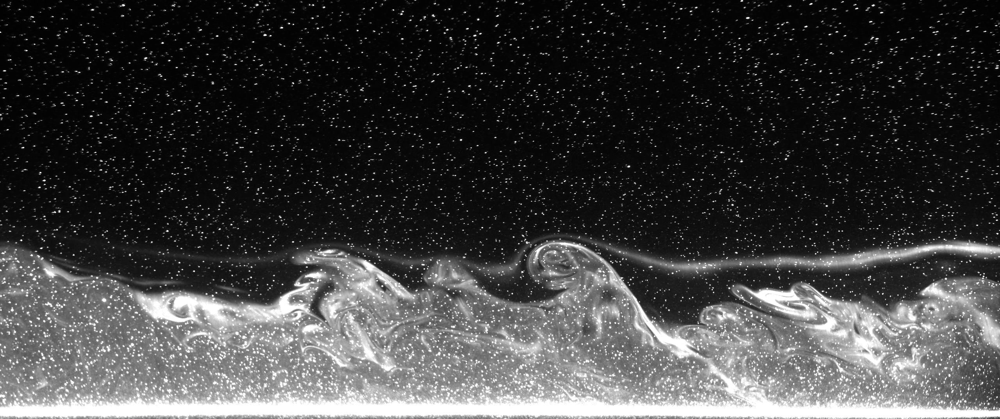

## Convection

  <figure>
    
    <figcaption>Particle streaks lit by LEDs in a rotating convection experiment where the centre of the bottom plate is heated (GFD lab, University of Oxford). Columnar structures at the centre, a baroclinic jet near the edges. Colours show time.</figcaption>
  </figure>

  <figure>
    <video controls loop muted playsinline preload="metadata">
      <source src="/file/Plume_IR_stratif.mp4" type="video/mp4">
    </video>
    <figcaption>Surface temperature from an infrared camera (white = warm, black = cold, ΔT of a few °C). The water column, first stratified in temperature, is heated from below. At first only surface convection is visible, driven by the warmer water cooling into the air. Then the plumes erode the stratification and reach the surface (the larger white structures).</figcaption>
  </figure>

  <figure>
    
    <figcaption>A thermal plume crossing a horizontal laser sheet 10 cm above a heated floor (Coriolis platform, LEGI). The bottom of a stably stratified column is heated, and Rhodamine dye released in the bottom layer marks the rising plume.</figcaption>
  </figure>

  <figure>
    
    <figcaption>Entrainment in a spin-up experiment on the Coriolis platform (LEGI), seen with particles and fluorescent dye.</figcaption>
  </figure>

## Vortex dynamics

  <figure>
    <video controls loop muted playsinline preload="metadata">
      <source src="/file/Tourbillon-exp-38.mp4" type="video/mp4">
    </video>
    <figcaption>Infrared view of the surface: a vortex formed while the tank was filling drifts across the field of view. Its core is colder than its shell (white = warm, black = cold).</figcaption>
  </figure>

  <figure>
    <video controls preload="metadata">
      <source src="/file/stabilite.mp4" type="video/mp4">
    </video>
    <figcaption>Stability of two vortices in the middle layer of a 2½-layer rotating shallow-water model, without (left) and with (right) friction at the upper lid. Friction makes the vortex split <em>faster</em>, the opposite of what you might expect. The motivation is the effect of sea-ice friction on Arctic eddies (Master's project).</figcaption>
  </figure>

